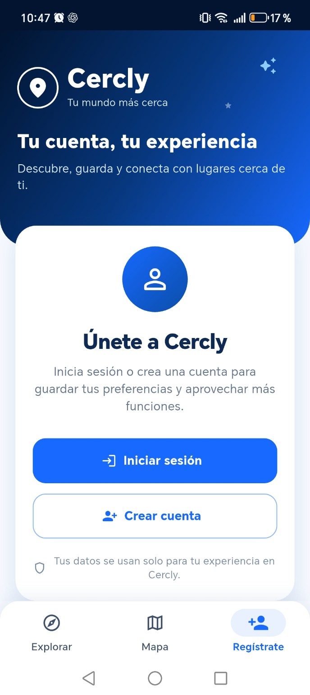
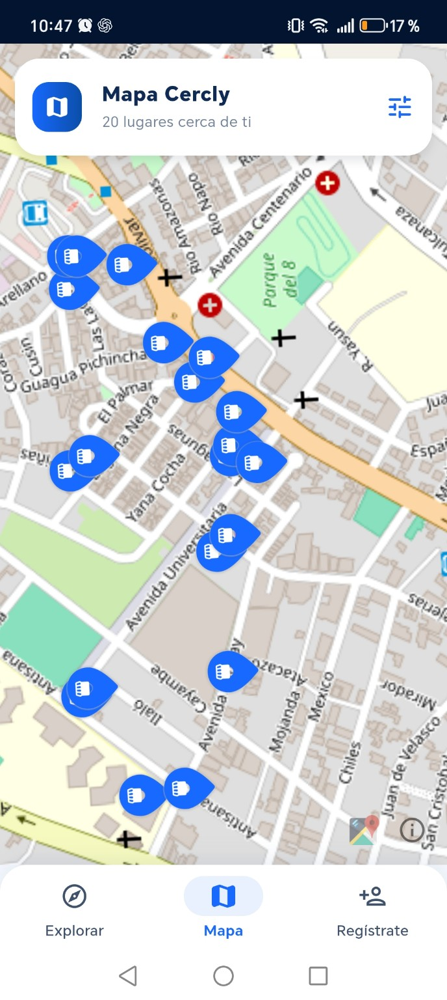
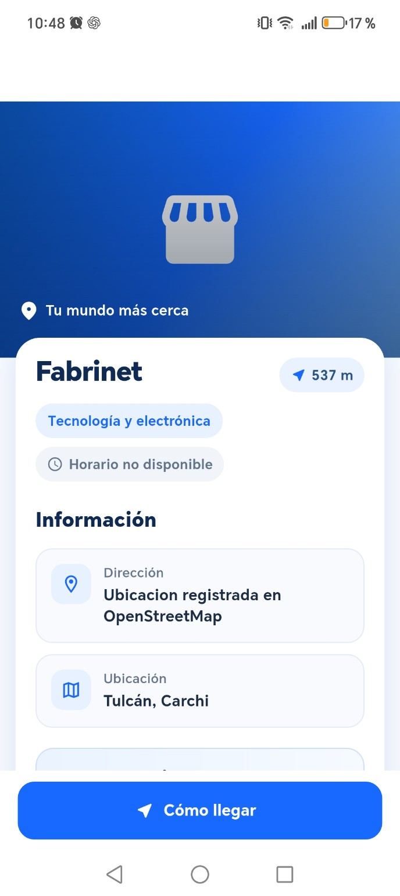
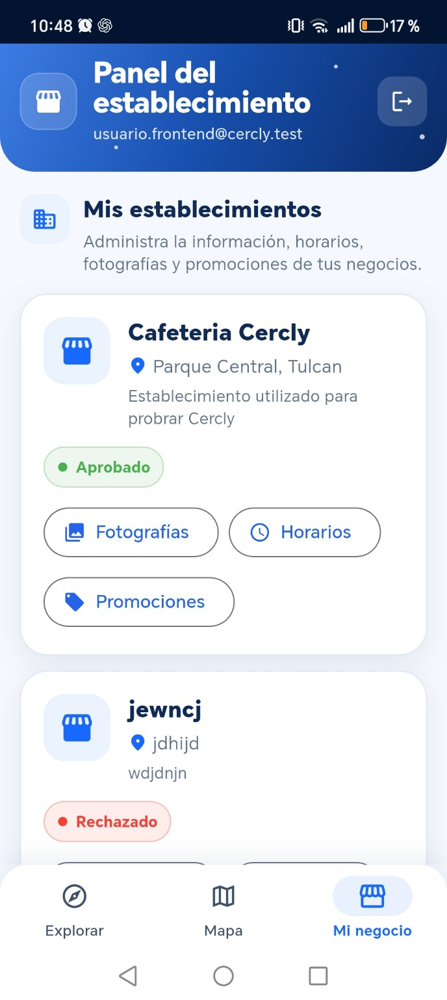
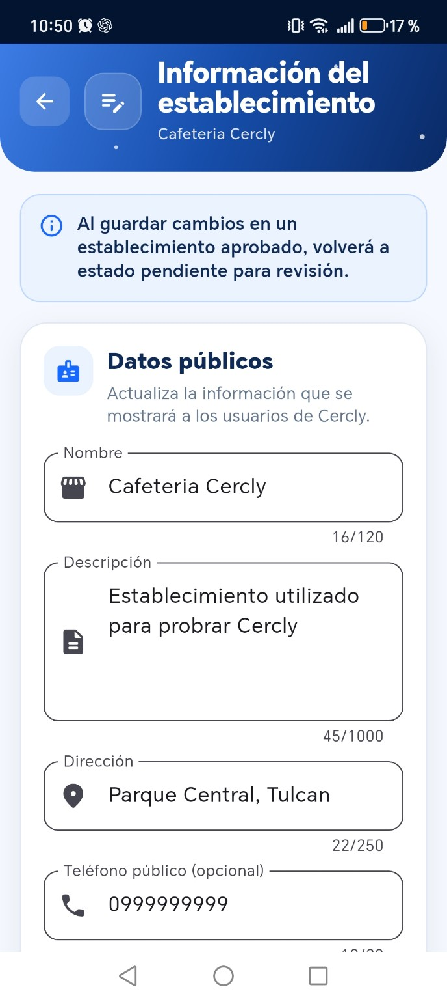
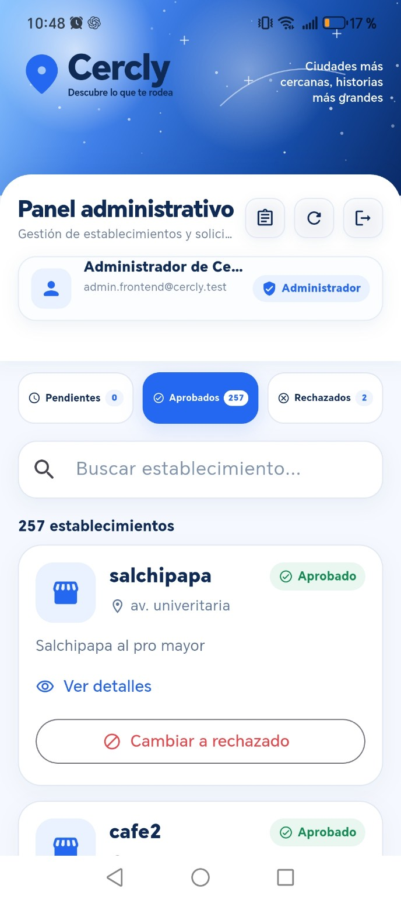
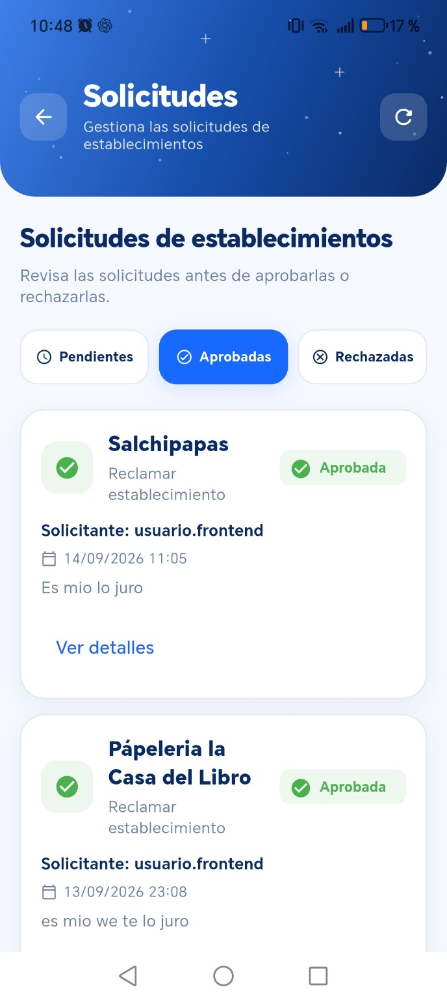

# Cercly 📍

**Descubre lo que te rodea.** Aplicación móvil de exploración de establecimientos y promociones cercanas, desarrollada con **Flutter y Dart**.

> **Estado:** proyecto académico en desarrollo y validación. Las capturas corresponden a datos de demostración/prueba; algunas funciones dependen de servicios externos y de la información disponible en cada zona.

## ¿Qué es Cercly?

Cercly ayuda a descubrir negocios próximos desde un teléfono Android. Reúne exploración por proximidad, categorías, visualización en mapa y fichas de establecimientos. También incorpora interfaces para los responsables de comercios y la administración de solicitudes.

## Galería de la aplicación

### Descubrimiento para usuarios

| Bienvenida y cuenta | Explorar negocios | Mapa de establecimientos | Detalle de establecimiento |
|:---:|:---:|:---:|:---:|
|  |  |  |  |

### Herramientas para establecimientos y administradores

| Panel del establecimiento | Editar información | Panel administrativo | Solicitudes |
|:---:|:---:|:---:|:---:|
|  |  |  |  |

## Funcionalidades demostradas

- **Exploración:** búsqueda y filtrado de establecimientos por categoría y proximidad.
- **Mapa:** representación geográfica de lugares cercanos.
- **Fichas públicas:** consulta de detalles y acceso a la opción «Cómo llegar».
- **Cuentas:** interfaces de inicio de sesión y registro.
- **Panel comercial:** consulta y edición de datos públicos, horarios, fotografías y promociones.
- **Administración:** revisión de establecimientos, estados de aprobación y solicitudes.
- **Promociones por proximidad:** módulo de notificaciones incorporado al proyecto, sujeto a permisos y pruebas en dispositivos.

## Tecnologías

| Tecnología | Propósito |
|---|---|
| Flutter / Dart | Aplicación móvil Android |
| Supabase | Backend y persistencia de datos |
| flutter_map y OpenStreetMap | Visualización cartográfica |
| geolocator | Geolocalización |
| flutter_local_notifications | Notificaciones locales |
| Git / GitHub | Control de versiones y trabajo colaborativo |
| GitHub Actions | Automatización de compilación APK |

## Estructura del proyecto

El código se organiza por funcionalidades dentro de `lib/features/`, con pantallas, modelos, servicios y controladores según cada módulo. La carpeta `docs/` contiene documentación y capturas.

## Ejecutar y comprobar el proyecto

Se requiere Flutter, Dart, Android SDK y la configuración adecuada de los servicios externos utilizados por el proyecto.

```bash
git clone https://github.com/Anthony8724/Cercly.git
cd Cercly
git switch develop
flutter pub get
flutter analyze
flutter test
```

La ejecución en dispositivo requiere la configuración del entorno de desarrollo. **No subas claves privadas ni archivos de configuración confidenciales al repositorio.**

## Validación local

Comprobaciones efectuadas sobre `develop` en octubre de 2026:

- `flutter pub get`: completado.
- `flutter analyze`: **0 errores reportados**, 4 recomendaciones informativas de estilo.
- `flutter test`: **98 pruebas aprobadas**, **8 omitidas**.

Estos resultados no equivalen a una auditoría de producción ni sustituyen pruebas de extremo a extremo.

## Equipo

Proyecto académico colaborativo de Ingeniería en Ciencias de la Computación, **Universidad Politécnica Estatal del Carchi (UPEC)**.

- **Anthony López:** liderazgo, programación e integración.
- **Jessica Cuasquén:** diseño, datos y pruebas.
- **Carlos Pantoja:** programación e integración.
- **Harol Chapi:** documentación, datos y calidad.

## Alcance y siguientes mejoras

Cercly está orientado inicialmente a pruebas en Tulcán, Ecuador. Las siguientes etapas incluyen ampliar las pruebas reales de navegación y notificaciones, fortalecer la documentación y mejorar la experiencia de uso.

---

**Repositorio:** [github.com/Anthony8724/Cercly](https://github.com/Anthony8724/Cercly)
