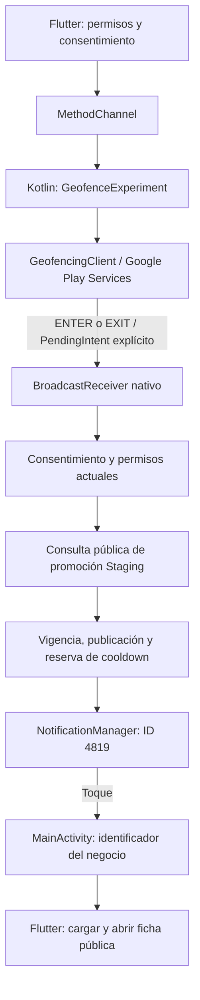

# Geofencing: arquitectura y GO técnico en Honor

Estado al 3 de noviembre de 2026: **GO técnico STAGING para el escenario ejecutado en Honor LLY-LX3, Android 14/MagicOS 8**, usando posiciones de desarrollo de FakeTraveler. No equivale a publicación pública, recorrido físico ni fiabilidad prolongada.

## Arquitectura implementada

Flutter/Dart organiza pantallas, controladores y servicios por funcionalidad. Este motor utiliza controladores propios, `ChangeNotifier` e `InheritedWidget` (`MonitorProximidadScope`); no depende de un isolate Flutter permanentemente activo ni de Riverpod. Supabase proporciona autenticación y consultas públicas sujetas a las reglas existentes. En esta entrega no se alteran bases remotas.

- `GeofenceExperiment.kt` registra únicamente el negocio y promoción ficticios UPEC autorizados, con radio 5000 m, expiración, ENTER/EXIT e initialTrigger ENTER. No hay GPS continuo ni WorkManager/sondeo remoto periódico. La actualización de zonas es manual en este prototipo.
- `PendingIntent` explícito entrega eventos GMS al receiver no exportado. En Android 12+ el de geofencing es mutable para permitir los extras de GMS; el toque y la alarma QA usan identidades distintas y flags seguros.
- ENTER se persiste antes de comprobar el cooldown; EXIT no publica avisos. La migración local conserva el significado de los timestamps históricos sin confundir señales QA con entradas reales.
- Los permisos Android son la autoridad: notificaciones, precisión y background se consultan de nuevo. Consentimientos independientes persisten localmente; segundo plano está desactivado inicialmente y requiere acción/explicación visible. Revocar o desactivar debe retirar el monitoreo autorizado.
- Después de ENTER se consulta la promoción; sin una validación segura se omite el aviso. No se inventan registros ni se envía la posición del usuario a Supabase para esta consulta.
- Reserva nativa sincronizada, persistente y compartida con el flujo foreground del experimento: 2 h por promoción, 15 min globales y máximo 3 avisos en una ventana de 24 h. Flutter conserva sus controles locales. QA permite reinicio local confirmado solamente en Staging.
- La notificación tiene canal Android y negocio en el payload. MainActivity entrega el ID a Flutter, que carga la ficha pública. La alarma QA (ID4822) tiene estado separado; no acredita una transición geográfica.
- `BOOT_COMPLETED` y `MY_PACKAGE_REPLACED` intentan restaurar cuando consentimiento, permisos y vigencia lo permiten. Un estado persistido `registered=true` no prueba registro actual; no existe una API pública de inventario de GeofencingClient. Se exige callback nuevo o evento real.
- BuildConfig, bandera Dart, host exacto y manifiesto Staging separan el experimento. El manifiesto normal no declara receivers QA ni ubicación background. No se genera APK Production en esta entrega.

## Ensayo del 3 de noviembre (UTC−5)

| Evidencia | Resultado |
|---|---|
| EXIT GMS con geofence UPEC | 12:56:53.663; aceptación nativa, sin aviso |
| Exterior consultado en Cercly | 8312 m, precisión 3 m, radio 5000 m |
| Único reinicio QA | 12:59:13–15; UPEC libre, global libre, 0/3 |
| Recorrido FakeTraveler | 61 muestras / 10 s / −1495 microgrados de latitud |
| Bloqueo anterior al cruce | 13:05:09: keyguard activo, pantalla apagada, Cercly en segundo plano |
| ENTER auténtico GMS | 13:05:18.627; ID `cercly-staging-upec-test` |
| Validación inicial | 13:05:18.628; accepted |
| Publicación nativa | 13:05:19.993; delivered_to_notification_manager |
| NotificationManager | ID4819 actualizado a las 13:05:19.981; visible desde 13:05:20.779 |
| Navegación tras toque del propietario | ADB 13:11:43–47: ficha Cercly Test — Proximidad, campus UPEC, Tulcán/Carchi |
| Restauración | 13:14:25 retirados GPS/network/fused mock; 13:15:09 verificados 0 proveedores mock, ubicaciones normales, servicio detenido y Logcat restaurado |

El aviso reutiliza ID4819: conserva la creación de una alerta anterior, pero cambia su actualización. Por eso se correlacionó el nuevo ENTER con `mUpdateTimeMs`, no con la mera existencia de una notificación. Los tiempos de energía sitúan el encendido después del ENTER y de la publicación. La validación inicial del log precede a la consulta de promoción; el resultado `posted` demuestra que el flujo completo llegó al gestor, no una traza HTTP independiente.

Durante la preparación hubo otro ENTER/EXIT transitorio anterior al reinicio, con notificación omitida por cooldown. Está conservado en el archivo original y no se utiliza como éxito final. No se atribuyó automáticamente a MagicOS.

Evidencias originales locales: `artifacts/honor-final-20261103-125424/`. SHA-256 del Logcat original: `61591a49548c3ba81b3752be31e2d42b3083151581a4533983fc17a536a02a75`. Este informe es una transcripción saneada; las capturas, datos del dispositivo y registros privados quedan fuera de Git. Honor enmascara coordenadas numéricas en dumpsys: se corroboró exterior mediante UI/distancia y frescura de muestras mock; no se almacenó ubicación personal.

## Límites y pendientes

No se cambió el comportamiento validado para la demostración. Quedan: recorrido físico, medición de batería/red, otras versiones de MagicOS, revocaciones/reinicio/proceso terminado en pruebas sistemáticas, emulador estable (Pixel 7 dio 139), múltiples negocios y sincronización de zonas. No se garantiza ejecución tras forzar detención.

Hay deuda técnica localizada: el fallo asíncrono de `removeGeofences()` anterior a un nuevo registro no tiene un resultado de error completo; el booleano de cooldown agrupa varios límites y fallo de persistencia; el reinicio QA puede retornar mientras hay evaluación en curso. Para mañana se comprueban callback/EXIT y contadores efectivos, sin introducir correcciones funcionales a última hora.

La ubicación background para promociones requiere evaluación de beneficio, divulgaciones, privacidad y revisión de distribución; **NO-GO para habilitarla públicamente en Production con esta evidencia sola**. Referencias: [geofencing Android](https://developer.android.com/develop/sensors-and-location/location/geofencing), [permiso background](https://developer.android.com/develop/sensors-and-location/location/permissions/background), [política de Google Play](https://support.google.com/googleplay/android-developer/answer/9799150). No se presume aprobación de Play.

La guía [de demostración](DEMO_ACADEMICA_2026-11-04.md) distingue ejecución real de GMS, simulación QA y alarma programada.
